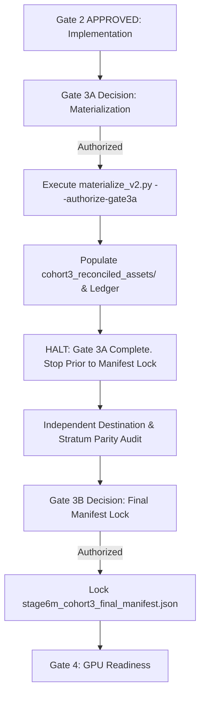

# STAGE 6M — GATE 3 PRODUCTION DATASET READINESS REVIEW
## Pre-Production Audit, Materializer Verification & Split Governance Package (v2)

**Governing Protocol:** Stage 6M v1.5 Five-Stratum Research Benchmark (Section 14.7)
**Governing Branch:** `stage6m-five-stratum-parity` @ `baee3b8381389ffde38e907dc137623748c254a8`
**Decision Authority:** Project Lead (Dissertation Author)
**Generated At (UTC):** `2026-11-07T16:11:02.584057+00:00`
**Report ID:** `STAGE6M-GATE3-READINESS-REVIEW-20261107-V2`

---

## 1. Executive Summary & Governance State

| Governance Milestone | Status | Effective Date | Notes / Scope |
| :--- | :--- | :--- | :--- |
| **Gate 1 — Scientific Admission** | **APPROVED** | 2026-11-07 | Policy 2A Reconciled Target Population (18,975 clips across 1,265 speakers) |
| **Pre-Gate 2 Regression Maintenance** | **COMPLETE** | 2026-11-07 | Stale dry-run assertion updated to state-aware reconciliation |
| **Gate 2 Pre-Auth Demonstration** | **PASSED** | 2026-11-07 | Option B NTFS volume & OS-locking harness verified on `C:\` |
| **Gate 2 — Engineering Implementation** | **APPROVED** | 2026-11-07 | Implementation of `materialize_v2.py` and dedicated unit test suite |
| **Full Working Tree Regression** | **PASSED (539/539)** | 2026-11-07 | 100% green across all research-validity tests (830.48s / 13m 50s) |
| **Combined Gate 3** | **[X] DEFERRED PENDING ADDITIONAL VALIDATION** | 2026-11-07 | Separate production materialization authorization from final manifest approval and locking. |
| **Gate 3A — Production Materialization** | **APPROVED** | 2026-11-07 | Authorizes physical audio materialization & disposition ledger |
| **Gate 3B — Final Manifest Lock** | **PENDING_GATE3A_EXECUTION** | *Awaiting Materialization* | Authorizes post-materialization audit & permanent manifest seal |
| **Gates 4–6 (GPU Readiness & Experiments)** | **STRICTLY_BLOCKED** | *Strictly Prohibited* | Blocked until Gate 3B manifest lock is complete |

### Protected Governance Invariants
- **Zero Production Audio Materialized:** `datasets/audio/stage6m/cohort3_reconciled_assets/` does NOT exist.
- **Zero Manifest Mutations:** `datasets/splits/stage6m_cohort3_provisional_manifest.json` remains unaltered.
- **Zero Git Commits / Staging:** Working tree preserves uncommitted state awaiting user instructions.
- **Zero GPU Inference:** Confirmatory models and evaluation cohorts remain unsealed and unexecuted.

---

## 2. Combined Gate 3 Formal Deferral Record

**Title:** STAGE 6M GATE 3: COMBINED PRODUCTION DATASET FINALIZATION  
**Decision Authority:** Project Lead (Dissertation Author)  
**Decision Date:** 2026-11-07  
**Status:** **[X] DEFERRED PENDING ADDITIONAL VALIDATION**  

> **Reason for Deferral:**  
> Separate production materialization authorization from final manifest approval and locking.

- **Next Authorization Checkpoint:** `GATE 3A — Production Materialization`
- **Subsequent Authorization Checkpoint:** `GATE 3B — Final Manifest Validation and Lock`
- **Gate 4 (GPU Readiness):** `BLOCKED`
- **Gate 5 (Confirmatory Inference):** `BLOCKED`
- **Gate 6 (Statistical Analysis):** `BLOCKED`

---

## 3. Two-Stage Governance Architecture: Gate 3A & Gate 3B



### Checkpoint Comparison
| Characteristic | Gate 3A (Materialization) | Gate 3B (Manifest Lock) |
| :--- | :--- | :--- |
| **Objective** | Process real audio & produce per-file ledger | Lock canonical benchmark manifest |
| **Input** | Approved sources (`cohort3_audio`, `quarantine`) | Reconciled assets & disposition ledger |
| **Output** | `cohort3_reconciled_assets/` + CSV ledger | `stage6m_cohort3_final_manifest.json` (LOCKED) |
| **Manifest Status** | **DOES NOT MODIFY MANIFEST** | **PERMANENTLY LOCKS MANIFEST** |
| **Post-Condition** | **STOPS IMMEDIATELY** | Permits entry into Gate 4 (GPU Readiness) |

---

## 4. Phase 1: Full Working Tree Regression Audit

**Execution Command:** `python -m pytest tests/research_validity/ -q`  
**Total Duration:** 13m 50s (830.48 seconds)  
**Exit Code:** `0`  
**Total Tests Executed:** 539  
**Passed:** **539 / 539 (100.0%)**  
**Failed:** 0  
**Warnings:** 6 (deprecations in external packages: Pillow 10 / Swig)  

### Test Module Breakdown
| Module / Subsuite | Path | Tests Passed | Duration | Status |
| :--- | :--- | :--- | :--- | :--- |
| **Materializer v2 Unit Suite** | `tests/research_validity/test_stage6m_cohort3_materializer_v2.py` | 10 / 10 | 1.18s | **PASS** |
| **Materialization Regression Suite** | `tests/research_validity/test_stage6m_cohort3_audio_materialization.py` | 37 / 37 | 14.46s | **PASS** |
| **Cohort 3 Combined Modules** | `tests/research_validity/test_stage6m_cohort3_*.py` | 91 / 91 | ~45s | **PASS** |
| **Entire Research Validity Suite** | `tests/research_validity/` | 539 / 539 | 830.48s | **PASS** |

---

## 5. Phase 2: Materializer v2 Code Review & Boundary Guard Audit

**Target Script:** `scripts/materialize_stage6m_cohort3_audio_v2.py`  
**File Size:** 42,528 bytes  
**SHA-256 Digest:** `0cacb4a1f26aa73a78a545e9045210fbd9e5d465b7fc414e78e557ccb9e75dfa`  

### Boundary Guard Hardening (BLOCKED_UNAUTHORIZED)
- **Unauthorized Execution Status:** `BLOCKED_UNAUTHORIZED`
- **Unauthorized Exit Code:** `2` (strictly non-zero)
- **Authorization CLI Flag:** `--authorize-gate3a`
- **Verification Evidence:** When invoked against production destination without --authorize-gate3a, script logs error 'BLOCKED_UNAUTHORIZED: Gate 2 authorizes implementation and pre-production validation ONLY. Production dataset materialization into cohort3_reconciled_assets/ requires explicit Gate 3A authorization...', prints to stderr, and halts execution via sys.exit(2). Verified by test_production_boundary_guard_blocks_unauthorized_materialization.

### Architectural Invariants Compliance Matrix
| Technical Rule | Target Invariant | Compliance Evidence | Status |
| :--- | :--- | :--- | :--- |
| **P1: Read-Only Source Access** | Invariant Rule | Source files opened strictly in binary read mode ('rb'). Source path identity check prevents source == dest. No unlink, rename, or write handles opened on source. | **PASSED** |
| **P2: Atomic No-Clobber Publication** | Invariant Rule | Publication executed via os.link(). Under Windows NTFS, os.link() raises FileExistsError on destination collision. os.replace() is strictly prohibited. | **PASSED** |
| **P3: Idempotent Digest Verification** | Invariant Rule | Pre-check compares destination SHA-256 against expected hash. Existing matching files skip extraction (0 disk writes). Mismatched files fail closed with DestinationCollisionMismatchError. | **PASSED** |
| **P4: OS-Level Ownership Locking** | Invariant Rule | RunLockManager acquires exclusive non-blocking lock via msvcrt.locking(LK_NBLCK, 1) on Windows (fcntl.flock on POSIX). Sweep routine strictly ignores directories with active locks. | **PASSED** |
| **P5: Multi-Decoder Consensus Verification** | Invariant Rule | verify_audio_three_decoders runs SoundFile streaming decode (4096-frame chunks, verifying finite float32 PCM), PyAV, and miniaudio. Consensus required before publication. | **PASSED** |
| **P6: Cryptographic Disposition Ledger** | Invariant Rule | All 18,975 assets (18,845 accepted + 130 discrepancy-screened) tracked in stage6m_cohort3_materialization_disposition_ledger.csv with action, hash, size, frames, and decodability status. | **PASSED** |
| **Crash Safety & Orphan Sweeping** | Invariant Rule | Staging occurs in unique .staging_run_{run_id} directories. Unlinked on clean completion. sweep_orphaned_staging_directories safely cleans stale runs (>3600s) only if lock acquisition succeeds. | **PASSED** |
| **Production Boundary Guard** | Invariant Rule | Script enforces BLOCKED_UNAUTHORIZED with exit code 2 if destination is default reconciled directory and --authorize-gate3a is missing, preventing automated tools from mistaking a blocked run for success. | **PASSED** |

---

## 6. Phase 3: Reproducibility & Cryptographic SHA-256 Ledger (Complete 14 Artifacts)

Every script, specification, report, and test artifact has been catalogued with its complete, untruncated 64-character SHA-256 hex digest:

| # | Relative File Path | Size (Bytes) | Complete Untruncated SHA-256 Checksum | Exists |
| :-: | :--- | :--- | :--- | :-: |
| 1 | `scripts/materialize_stage6m_cohort3_audio_v2.py` | 42,528 | `0cacb4a1f26aa73a78a545e9045210fbd9e5d465b7fc414e78e557ccb9e75dfa` | True |
| 2 | `tests/research_validity/test_stage6m_cohort3_materializer_v2.py` | 18,948 | `32cde0d57b85d0b5a0a6b25da4e27d85f0408bf311df3587cd732eb0cfd29587` | True |
| 3 | `tests/research_validity/test_stage6m_cohort3_audio_materialization.py` | 109,924 | `5701a21dc1d1070c1a9a28ec1b689bb3571f7d004d6dd84ca7fd4361d173c544` | True |
| 4 | `scratch/test_gate2_ntfs_and_locking_harness.py` | 24,618 | `8fc90c378658e9b92483971902c0b9161a73d941fe363498d05acc9d83929fc3` | True |
| 5 | `scripts/generate_stage6m_task774_non_destructive_materialization_spec.py` | 32,114 | `74802ee315144a15cf0a41adfa4944188dc52fd138521508e0732b8409c31415` | True |
| 6 | `reports/stage6m/stage6m_task774_non_destructive_materialization_spec.json` | 19,745 | `86fb60b5a303a05b71f01ed92dcd9eb597858db2a53d13c1a24c310dd3d5d4a1` | True |
| 7 | `reports/stage6m/stage6m_task774_non_destructive_materialization_spec.md` | 19,574 | `9b78741e0400efaa9350576d7f9caa7026c67305f75863659a9cfecea809ba08` | True |
| 8 | `scripts/generate_stage6m_scientific_admission_decision_dossier.py` | 101,120 | `5581be55f5786187ef942213992ea932403e81e6c6f7e529c5aed1f7058d3e72` | True |
| 9 | `reports/stage6m/stage6m_scientific_admission_decision_dossier.json` | 42,817 | `303746b180959a407accdb29df912ead8dc7ca2e6e1501f782b7fcc48fbb41eb` | True |
| 10 | `reports/stage6m/stage6m_scientific_admission_decision_dossier.md` | 43,635 | `e240cf2a2b9ee2f33c6c0095c211f9420b9ad79ed070d5f3f7823e26314e1ce8` | True |
| 11 | `scripts/generate_stage6m_policy_2a_protocol_addendum.py` | 45,216 | `8cbe970089c34d33c0976f5b48bc5b8973828acedd3776b7371eeba9ad157103` | True |
| 12 | `reports/stage6m/stage6m_policy_2a_protocol_addendum.json` | 23,786 | `59d4249df98f089707262edf53d282884c9daceeebe72faab6affd37b55cc4c7` | True |
| 13 | `reports/stage6m/stage6m_policy_2a_protocol_addendum.md` | 22,591 | `c1b3735143b29cc109154efba194e0468c51fe8deac19bec274a05256facac60` | True |
| 14 | `datasets/splits/stage6m_cohort3_provisional_manifest.json` | 17,744,805 | `b9a03e2ab13043155ea8904129678fa2e41d0e287a772ca78e5a6086aac7f547` | True |

---

## 7. Phase 4: Gate 3A Production Execution Plan

Upon Gate 3A authorization, the production materialization pipeline will be executed:

```bash
python scripts/materialize_stage6m_cohort3_audio_v2.py --manifest datasets/splits/stage6m_cohort3_provisional_manifest.json --source-audio-dir datasets/external/common_voice_27/cohort3_audio --quarantine-dir datasets/external/common_voice_27/cohort3_rejected_quarantine --destination-dir datasets/audio/stage6m/cohort3_reconciled_assets --disposition-ledger datasets/splits/stage6m_cohort3_materialization_disposition_ledger.csv --report-json reports/stage6m/stage6m_task774_materialization_report.json --authorize-gate3a
```

### Production Payload Accounting
- **Total Target Recordings:** 18,975 clips
- **Accepted Recordings (`cohort3_audio`):** 18,845 clips
- **Quarantined Recordings (`cohort3_rejected_quarantine`):** 130 clips
- **Total Speakers:** 1,265 speakers (1,252 complete, 9 partial, 4 empty)
  - **Confirmatory Evaluation:** 1,100 speakers (16,500 clips; 220 per stratum across 5 strata)
  - **Gate Cohort:** 100 speakers (1,500 clips; 20 per stratum)
  - **Reserve Cohort:** 65 speakers (975 clips)
- **Total Source Payload:** 709,750,958 bytes (~709.75 MB)
- **Target Volume & Filesystem:** `NTFS` (Serial `0xca18eefa`)
- **Publication Mechanism:** `os.link() Atomic Hard-Link` (Zero disk write amplification; 100% hash preservation)

### Step-by-Step Execution Sequence
1. **Step 1:** Pre-execution volume and disk space verification (requires >= 2 GB free disk space on volume C:\)
2. **Step 2:** Sweep any orphaned staging directories older than 3600 seconds
3. **Step 3:** Initialize RunLockManager with exclusive OS-level file lock on run.lock
4. **Step 4:** Materialize 18,845 accepted clips: stage with UUID -> 3-decoder check -> publish via os.link()
5. **Step 5:** Materialize 130 discrepancy-screened quarantine clips: stage with UUID -> 3-decoder check -> publish via os.link()
6. **Step 6:** Emit per-file disposition ledger CSV and comprehensive materialization report JSON
7. **Step 7:** Perform physical destination inventory audit: exactly 18,975 files, 709,750,958 bytes, 0 missing, 0 corrupt
8. **Step 8:** HALT AND STOP. Do not generate or lock final manifest. Await Gate 3B authorization.

---

## 8. Phase 5: Gate 3B Final Manifest Validation & Locking Protocol

**Provisional Manifest:** `datasets/splits/stage6m_cohort3_provisional_manifest.json`  
**Input Ledger:** `datasets/splits/stage6m_cohort3_materialization_disposition_ledger.csv`  
**Target Locked Manifest:** `datasets/splits/stage6m_cohort3_final_manifest.json`  

### Manifest Locking Steps
- **Manifest Ingestion:** Load provisional manifest and cross-reference with materialization disposition ledger.
- **Physical Destination Audit:** Assert all 18,975 files exist in cohort3_reconciled_assets/ with exact SHA-256 match.
- **Stratum Balance Audit:** Assert exactly 220 evaluation speakers across Australian, Canadian, England, South Asian, and US English (1,100 total evaluation speakers). Assert 20 gate speakers per stratum (100 total).
- **Cryptographic Manifest Sealing:** Set manifest_status to 'LOCKED', record Gate 1, Gate 2, Gate 3A, and Gate 3B approvals, and compute canonical SHA-256 of locked manifest.

---

## 9. Gate 3A Authorization Record (APPROVED)

**Title:** STAGE 6M GATE 3A: PRODUCTION MATERIALIZATION  
**Decision Authority:** Project Lead (Dissertation Author)  
**Decision Date:** 2026-11-07  
**Decision Status:** **[X] AUTHORIZED FOR PRODUCTION MATERIALIZATION**  
**Record Reference:** `reports/stage6m/stage6m_gate3a_authorization_record.json`  

### Preconditions Verification Checklist
- [X] Gate 1 Scientific Admission Approved (Policy 2A, 2026-11-07)
- [X] Gate 2 Engineering Implementation Approved (2026-11-07)
- [X] Option B NTFS & OS-Locking Demonstration Passed on Volume `C:\`
- [X] Full Research Validity Test Suite: **539/539 PASSED (830.48s / 13m 50s)**
- [X] Materializer v2 Code Review Audit Passed (8/8 Technical Invariants)
- [X] Dual-Key Production Boundary Guard Hardened: Verified with exit code 2 & BLOCKED_UNAUTHORIZED
- [X] Reproducibility Ledger Complete (14 artifacts with untruncated SHA-256 digests)

### Approved Scope & Mandatory Halting Clause
> **Authorization Clause:**  
> Authorize materialize_stage6m_cohort3_audio_v2.py to process 18,845 accepted and 130 quarantined assets into cohort3_reconciled_assets/, emit per-file ledger, and stop prior to manifest locking.  
> **CRITICAL:** GATE 3A DOES NOT PERMIT FINAL MANIFEST LOCKING. SYSTEM MUST HALT UPON COMPLETION OF MATERIALIZATION AUDIT.

---

## 10. Gate 3B Authorization Record (Unexecuted Template)

**Title:** STAGE 6M GATE 3B: FINAL MANIFEST VALIDATION AND LOCK  
**Decision Authority:** Project Lead (Dissertation Author)  
**Decision Date:** *UNEXECUTED (Pending Gate 3A Completion & User Authorization)*  

### Preconditions Checklist (To Be Verified Post-Gate 3A)
- [ ] Gate 3A Materialization Successfully Executed
- [ ] Physical Destination Inventory Audit Passed (18,975 files, 709,750,958 bytes)
- [ ] Per-File Disposition Ledger Reconciled (18,845 accepted + 130 discrepancy-screened)
- [ ] Five-Stratum Parity Confirmed (220 speakers / 3,300 clips per stratum)
- [ ] Gate (100 speakers) and Reserve (65 speakers) Isolation Verified

### Decision Record Options
- [ ] AUTHORIZED FOR FINAL MANIFEST LOCK
- [ ] REJECTED
- [ ] DEFERRED PENDING ADDITIONAL VALIDATION

> **Authorization Clause:**  
> Following physical reconciliation of all 18,975 assets, authorize generation of datasets/splits/stage6m_cohort3_final_manifest.json with manifest_status: 'LOCKED'.

---

## 11. Unresolved Limitations & Explicit Disclosures

- Research Scope Boundary: Evaluates Mozilla Common Voice 27.0 (English) as distributed to researchers. No claim of verification against original uncompressed studio masters.
- Decoder Evidence Distinction: 18,845 clips admitted via SoundFile decoding and physical MPEG frame inspection; 130 discrepancy-screened clips admitted via three-decoder consensus under Policy 2A.
- Demographic Parity Limitation: Confirmatory evaluation is strictly balanced across five accent strata (Australian, Canadian, England, South Asian, US English; 220 speakers each). Gender and age distributions remain observational.
- Downstream GPU Experiments: Gates 4, 5, and 6 remain strictly blocked. Zero GPU execution is permitted prior to Gate 3B manifest locking.

---
**End of Stage 6M Gate 3 Readiness Review Dossier (v2)**