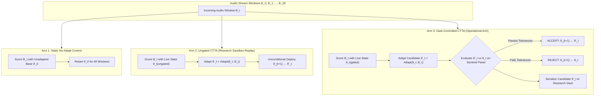

# Stage 6M Protocol Proposal: Multi-Model Cumulative Adaptation & Cross-Dataset Confirmatory Validation (Revised Draft)

**Protocol Version:** `v1.3.4-stage6m-self-authorization-amendment` (Formal Amendment to Protocol Lineage)  
**Prior Historical Protocol:** `v1.3.3-stage6m-reconciled-decision-pack`  
**Governing Standard:** ADR-005 (Amended via AMENDMENT-001)  
**Document Status:** Preregistered Experimental Protocol Authorized for Execution under Amendment-001  
**Current Governance Decision:** **AUTHORIZED FOR EXECUTION UNDER PROTOCOL AMENDMENT (PROJECT LEAD AUTHORIZATION)**  
**Submission / Amendment Date:** 2026-10-20  

---

## 1. Executive Summary & Governance Invariant

### 1.1 The Epistemic Boundary: Protocol Design vs. Scientific Proof
This document represents a **preregistered experimental protocol proposal**, not proof of its scientific hypotheses. The project strictly enforces the four-way distinction:
1. **Protocol Design:** The formal methodology proposed herein.
2. **Implementation Verification:** Code tests verifying data isolation, configuration consistency, and algorithmic contracts.
3. **Experimental Evidence:** Empirical results gathered during benchmark execution.
4. **Scientific Conclusion:** What those empirical results rigorously justify claiming.

> [!CRITICAL]
> **Governance Invariant (Issue 1 Resolution)**:
> Stage 5M is **CLOSED & ARCHIVED**. Prior historical state: `HOLD — STRICTLY NOT AUTHORIZED`. Confirmatory execution of Stage 6M is now **AUTHORIZED FOR EXECUTION UNDER PROTOCOL AMENDMENT** v1.3.4 (Amendment-001) recorded in Section 11.
> Passing implementation or protocol tests demonstrates software consistency; **it does not constitute empirical validation of the underlying scientific hypotheses**.
> All confirmatory executions strictly obey the frozen manifest and experimental invariants.

### 1.2 Central Research Question
Following the findings of Stage 5M, Stage 6M addresses the primary unresolved scientific question:
$$\boxed{\begin{aligned}
\text{\textbf{Central Research Question:}} &\quad \text{Does the Disparity Safety Gate (DSG) control cumulative adaptation-induced harm} \\
&\quad \text{relative to ungated continual test-time adaptation over multi-step streaming trajectories,} \\
&\quad \text{while preserving useful adaptation gains on independent speakers and held-out model families?}
\end{aligned}}$$

---

## 2. Scientific Gap Analysis & Lessons from Stage 5M

```
┌─────────────────────────────────────────────────────────────────────────────────────────────┐
│                                 STAGE 5M EVIDENCE BOUNDARIES                                │
├───────────────────────────────┬───────────────────────────────┬─────────────────────────────┤
│ Dimension                     │ Stage 5M Established Scope    │ Unanswered Scientific Gap   │
├───────────────────────────────┼───────────────────────────────┼─────────────────────────────┤
│ Adaptation Horizon            │ Single-step updates strictly  │ Multi-step cumulative error │
│                               │ from unadapted base model     │ drift and trajectory health │
├───────────────────────────────┼───────────────────────────────┼─────────────────────────────┤
│ Rejected Candidates (N=2,560) │ Candidate weights discarded   │ Downstream counterfactual   │
│                               │ online; unobserved downstream │ outcomes completely unknown │
├───────────────────────────────┼───────────────────────────────┼─────────────────────────────┤
│ Missing Accepted Updates      │ 12 accepted updates lacked    │ Sensitivity range wide      │
│                               │ serialized counterfactuals    │ ([3.75%, 18.75%])           │
├───────────────────────────────┼───────────────────────────────┼─────────────────────────────┤
│ Generalization Evidence       │ L2-ARCTIC (N=12 speakers,     │ True population validity    │
│                               │ 6 overlapping with Stage 3M)  │ on independent speakers     │
└───────────────────────────────┴───────────────────────────────┴─────────────────────────────┘
```

---

## 3. Experimental Architecture: Three Matched Stream Arms (Issue 2 Resolution)

To evaluate cumulative adaptation trajectories rather than isolated single-step transitions, Stage 6M streams three matched, concurrent experimental arms across identical audio window sequences ($B_0, B_1, \dots, B_{29}$):



### 3.1 Arm Roles & Invariants
1. **Arm 1: Static No-Adapt Reference Trajectory**:
   The fixed initial model $\theta_0$ processes every window without adaptation: $\hat{Y}_t = f_{\theta_0}(X_t)$. Controls for natural temporal acoustic difficulty across windows.
2. **Arm 2: Ungated CTTA (Isolated Research Sandbox Replay)**:
   Continuously adapts using entropy/diversity minimization (SUTA, DSUTA, DMSUTA) with unconditional deployment: $\theta_{t+1} \leftarrow \operatorname{Adapt}(\theta_t, X_t)$.
   > [!WARNING]
   > **Research-Only Isolation**: Arm 2 is executed strictly within a sandboxed research replay branch. It measures unconstrained adaptation drift and divergence failure modes, but is never exposed as an operational deployment.
3. **Arm 3: Gate-Controlled CTTA (Operational System)**:
   The candidate update $\theta'_t$ is screened by the Disparity Safety Gate on the Sentinel Panel ($S$). Deployed if accepted; discarded and $\theta_t$ retained if rejected.

---

## 4. Multi-Step Cumulative Estimands & Terminal-Window Rules

As detailed in [`stage6m_temporal_estimands.md`](file:///c:/Users/venka/Downloads/final%20year%20project%20main/reports/stage6m/stage6m_temporal_estimands.md), Stage 6M separates four distinct estimands:

### 4.1 Candidate-Level Estimands
1. **One-Step Immediate Prospective Effect ($h = 1$):**
   $$\Delta E_{t,1}^{\text{cand}} = E(\theta'_t, B_{t+1}) - E(\theta_t, B_{t+1})$$
2. **Multi-Step Rollout Horizons ($h \in \{3, 5\}$):**
   - **Policy A (Frozen-Weights Rollout):** Evaluates parameter persistence across $B_{t+1} \dots B_{t+h}$ without taking further adaptation steps.
   - **Policy B (Active-Branch Rollout):** Candidate branch and retained branch each continue streaming and adapting independently under the assigned streaming rule, measuring true trajectory divergence.

### 4.2 End-to-End Policy Contrasts
1. **Primary Contrast (Gated vs. Ungated CTTA):**
   $$\Delta_{\text{Gated-Ungated}} = E_{\text{Arm 3 (Gated)}}(B_{0:T-1}) - E_{\text{Arm 2 (Ungated)}}(B_{0:T-1})$$
   (Negative values $\Delta < 0$ indicate the gate mitigated word errors).
2. **Secondary Contrast (Gated vs. Static No-Adapt):**
   $$\Delta_{\text{Gated-Static}} = E_{\text{Arm 3 (Gated)}}(B_{0:T-1}) - E_{\text{Arm 1 (Static)}}(B_{0:T-1})$$
   (Both contrasts reported side-by-side; outperforming ungated CTTA does not guarantee outperforming static No-Adapt).

### 4.3 Terminal-Window Accounting Invariant
In a stream of $T = 30$ windows ($B_0 \dots B_{29}$):
- Windows $t = 0 \dots 28$ ($29$ windows): Ingest audio, transcribe, adapt candidate, make gate decision, update or retain state.
- Window $t = 29$ ($1$ window): **Terminal Prediction-Only Window**. Transcribed and scored offline; **no adaptation update is initiated** because no window $B_{30}$ exists to evaluate downstream prospective impact.
- **Exact Candidate Count per Stream:** $N_{\text{cand}} = T - 1 = \mathbf{29\text{ candidate evaluations}}$.

---

## 5. Vector Prospective Harm Classification (Correction 2 Resolution)

A critical correction to the earlier proposal: **evaluating a single overall error metric ($\Delta E_{t+1} > 0$) is insufficient because an update can reduce overall WER while causing severe subgroup regression or disparity expansion**.

Stage 6M defines prospective outcomes as a vector in $\mathbb{R}^3$ with exact units in **percentage points (pp)**:
$$\boldsymbol{\Delta}_{t,h} = \left( \Delta R_{t,h}, \, \max_g \Delta g_{t,h}, \, \Delta D_{t,h} \right)$$
where:
- $\Delta R_{t,h} = \text{WER}(\theta'_t, B_{t:t+h}) - \text{WER}(\theta_t, B_{t:t+h})$ (Overall Risk Change, pp).
- $\max_g \Delta g_{t,h} = \max_{g \in \mathcal{G}} \left[ \text{WER}_g(\theta'_t, B_{t:t+h}) - \text{WER}_g(\theta_t, B_{t:t+h}) \right]$ (Maximum Subgroup Regression, pp).
- $\Delta D_{t,h} = D(\theta'_t, B_{t:t+h}) - D(\theta_t, B_{t:t+h})$ (Disparity Expansion, pp), where $D = \max_g \text{WER}_g - \min_g \text{WER}_g$.

### 5.1 Prospective Outcome Classification Rules
A candidate update evaluated over horizon $h$ is classified as:

```
┌─────────────────────────────────────────────────────────────────────────────────────────────┐
│                           VECTOR PROSPECTIVE OUTCOME CLASSIFICATION                         │
├────────────────┬────────────────────────────────────────────────────────────────────────────┤
│ Category       │ Formal Mathematical Classification Rule                                    │
├────────────────┼────────────────────────────────────────────────────────────────────────────┤
│ HARMFUL        │ ΔR_{t,h} > 0.00 pp  OR  max_g Δg_{t,h} > +2.00 pp  OR  ΔD_{t,h} > +2.00 pp  │
│ (Any Safety    │ (Candidate increased overall error, degraded any subgroup beyond tolerance,│
│ Violation)     │  or expanded group disparity beyond tolerance on future windows)           │
├────────────────┼────────────────────────────────────────────────────────────────────────────┤
│ BENEFICIAL     │ ΔR_{t,h} < 0.00 pp  AND  max_g Δg_{t,h} ≤ +2.00 pp  AND  ΔD_{t,h} ≤ +2.00 pp │
│ (Net Useful)   │ (Candidate improved overall WER without exceeding subgroup/disparity limits)│
├────────────────┼────────────────────────────────────────────────────────────────────────────┤
│ NEUTRAL        │ ΔR_{t,h} = 0.00 pp  AND  max_g Δg_{t,h} ≤ +2.00 pp  AND  ΔD_{t,h} ≤ +2.00 pp │
│ (Equivalent)   │ (Identical overall word errors with zero subgroup safety violations)       │
├────────────────┼────────────────────────────────────────────────────────────────────────────┤
│ UNAVAILABLE    │ Missing comparator, checkpoint corruption, or unobserved counterfactual    │
└────────────────┴────────────────────────────────────────────────────────────────────────────┘
```

- **Separation of Operational Gate from Future Harm:** Sentinel Panel confidence bounds ($\text{UCB}_{95} \le \epsilon$) govern live deployment decisions; vector $\boldsymbol{\Delta}_{t,h}$ measures true empirical consequences on future streaming audio.
- **Status:** `PROPOSED & FORMALIZED`.

### 5.2 Dual Safety–Utility Evaluation Framework
The research objective is to measure the trade-off, not to minimize or maximize acceptance rate blindly:

```
                  SAFETY DIMENSION                              UTILITY DIMENSION
        ┌───────────────────────────────────┐         ┌───────────────────────────────────┐
        │ • Prospective Harm Rate           │         │ • Operational Acceptance Rate     │
        │ • Maximum Subgroup Regression     │   vs.   │ • Downstream Improvements Retained│
        │ • Disparity Expansion (ΔD)       │         │ • Net WER Reduction vs. No-Adapt  │
        │ • Trajectory Drift Suppression    │         │ • Cumulative Trajectory Gain      │
        └───────────────────────────────────┘         └───────────────────────────────────┘
```

#### Two-Phase Threshold Protocol
- **Phase 1 (Confirmatory Test):** Executed strictly under **Frozen Safety Thresholds** ($\epsilon_R = 0.00\text{ pp}$, $\epsilon_G = +2.00\text{ pp}$, $\epsilon_D = +2.00\text{ pp}$, $B = 1000$, $\alpha = 0.05$).
- **Phase 2 (Pareto Frontier Exploration):** Alternative threshold policies evaluated strictly on the separate `datasets/splits/calibration.csv` partition—**never tuning thresholds on confirmatory test data**.

---

## 6. Controlled Offline Counterfactual Replay Vault & Candidate Provenance (Issue 3 & 4 Resolution)

As specified in [`stage6m_replay_vault_spec.md`](file:///c:/Users/venka/Downloads/final%20year%20project%20main/reports/stage6m/stage6m_replay_vault_spec.md):

### 6.1 Prospective Replay Architecture & Provenance Recording Schema
For every candidate evaluation $t$ in Stage 6M (both ACCEPT and REJECT):
1. **Candidate State Serialization:** The model checkpoint delta $\Delta \theta'_t$ and comparator state $\theta_t$ are written to `checkpoints/stage6m/research_vault/models/`.
2. **Deterministic Replay Recipe:** Optimization hyperparameters, seed, audio clip IDs, and PyTorch RNG state are logged to `checkpoints/stage6m/research_vault/recipes/`.
3. **Structured Provenance Manifest:** An 8-field provenance record logging candidate ID, checkpoint hashes, seeds, and status is appended to `stage6m_candidate_provenance_manifest.jsonl`.
4. **Offline Post-Stream Evaluation:** An isolated audit worker evaluates both models on subsequent window $B_{t+1}$ using quarantined reference transcripts $Y_{t+1}$, populating the full $2 \times 3$ prospective decision matrix:

| Operational Decision | Prospectively Beneficial ($\mathcal{C}_{\text{ben}}$) | Prospectively Neutral ($\mathcal{C}_{\text{neut}}$) | Prospectively Harmful ($\mathcal{C}_{\text{harm}}$) | Total |
| :--- | :---: | :---: | :---: | :---: |
| **ACCEPT (Model Updated)** | Safe Adaptation Opportunity | Neutral Accepted | **Hazardous False Acceptance** | $N_{\text{Accept}}$ |
| **REJECT (Model Retained)** | **Opportunity Cost (Excess Conservative)**| Neutral Rejected | **Counterfactually Harmful Candidate Rejected** | $N_{\text{Reject}}$ |
| **Total Evaluations** | $N_{\text{Ben}}$ | $N_{\text{Neut}}$ | $N_{\text{Harm}}$ | $N_{\text{Total}}$ |

> [!CAUTION]
> **Causal Interpretation Boundary for Rejected Updates:**
> A candidate update rejected by the operational gate and evaluated as harmful on window $B_{t+1}$ is formally classified as **Rejection of a Counterfactually Harmful Candidate State**, *not* a proven operational catastrophe averted. Because the candidate model was never deployed into the live streaming trajectory, its downstream divergence was unobserved. Causal protection against cumulative degradation is measured exclusively via the trajectory contrast between Arm 3 (Gated) and Arm 2 (Ungated).
>
> **Stage 5M Historical Invariant**: This replay vault operates strictly prospectively. **It does not recover or alter historical Stage 5M rejected candidates**, whose weights were permanently discarded upon rejection.

### 6.2 Checkpoint Integrity, Preflight Checkpoint Verification & Numerical Reproducibility
- **Preflight Checkpoint Verification:** Automated preflight script tests that checkpoints serialize and reload cleanly with zero drift before streams begin.
- **Parameter Deserialization:** Exact parameter integrity is required: $L_\infty(\theta_{\text{saved}}, \theta_{\text{loaded}}) = 0.0$.
- **Numerical Inference Tolerance:** Forward-pass logits match within $\text{atol} = 1.0 \times 10^{-5}$ across GPU kernels; decoded greedy CTC transcripts must match character-for-character.
- **Missingness Policy:** Missing outcomes are explicitly labeled `UNAVAILABLE`. Silent imputation to neutral ($0.00\text{ error change}$) is strictly prohibited.

---

## 7. Dataset Integrity & Two-Cohort Protocol Architecture (Issue 1 & 6 Resolution)

As documented in [`stage6m_data_integrity_audit.md`](file:///c:/Users/venka/Downloads/final%20year%20project%20main/reports/stage6m/stage6m_data_integrity_audit.md):

### 7.1 Mathematical Speaker Disjointness Proof
Extracting literal client speaker identifiers across all manifests (including the Common Voice 27.0 evaluation stream with $N = 60$ independent speakers across 6 accent strata) proves:
$$\left| S_{\text{stage5\_external\_eval}} \cap S_{\text{stage5\_sentinel\_panel}} \right| = 0 \quad (\mathbf{Zero\ Overlap})$$
$$\left| S_{\text{stage5\_external\_eval}} \cap S_{\text{stage4\_characterization}} \right| = 0 \quad (\mathbf{Zero\ Overlap})$$
$$\left| S_{\text{stage5\_external\_eval}} \cap S_{\text{calibration}} \right| = 0 \quad (\mathbf{Zero\ Overlap})$$

### 7.2 Two-Cohort Protocol Architecture (Replication vs. Confirmatory)
To eliminate any ambiguity regarding evaluation-data exposure history and ensure adequate statistical power for the joint safety–utility claim, Stage 6M adopts a formal **Two-Cohort Protocol Architecture**:

```
┌─────────────────────────────────────────────────────────────────────────────────────────────┐
│                           TWO-COHORT EXPERIMENTAL ARCHITECTURE                              │
├────────────────────┬──────────────────────────────────┬─────────────────────────────────────┤
│ Cohort             │ Dataset & Manifest               │ Formal Scientific Role              │
├────────────────────┼──────────────────────────────────┼─────────────────────────────────────┤
│ COHORT 1           │ stage5_external_eval.csv         │ CROSS-DATASET REPLICATION &         │
│ (Replication)      │ (Exposed in Stage 5M exploration;│ MULTI-STEP REPLAY                   │
│                    │  N = 60 speakers, 10/stratum)    │                                     │
├────────────────────┼──────────────────────────────────┼─────────────────────────────────────┤
│ COHORT 2           │ Option A Confirmatory Cohort     │ PRIMARY BLIND CONFIRMATION          │
│ (Confirmatory)     │ Initial Planning: N = 180 spk    │ (Zero prior project exposure;       │
│                    │ High-Power Target: N = 240 spk   │  Quarantined references;            │
│                    │ (PROPOSED — NOT YET CREATED)     │  Joint safety-utility evaluation)   │
└────────────────────┴──────────────────────────────────┴─────────────────────────────────────┘
```

- **Cohort 1 (Replication & Multi-Step Replay):** Preserves `stage5_external_eval.csv` ($N = 60$ independent speakers, $10$ per stratum across 6 accent groups). Because this dataset was exposed during preliminary Stage 5b and historical exploratory benchmarking (`eight_model_benchmark.csv`), results from Cohort 1 are strictly characterized as cross-architecture replication and replay dynamics, not pristine blind confirmation.
- **Cohort 2 (Primary Confirmatory Blind Benchmark — Option A Expansion):** As approved in the Supervisor's Research Decision, Stage 6M formally adopts **Option A (Confirmatory Sample Size Expansion)**.
  - **Initial Planning Target:** $N = 180$ independent speakers ($30$ speakers per stratum across 6 prespecified accent groups).
  - **Recommended High-Power Target:** $N = 240$ independent speakers ($40$ speakers per stratum across 6 groups).
  - **Data Feasibility Status:** Audited in [`stage6m_data_feasibility_audit.md`](file:///c:/Users/venka/Downloads/final%20year%20project%20main/reports/stage6m/stage6m_data_feasibility_audit.md) against Mozilla Common Voice 27.0 (`cv-corpus-27.0-2026-09-11`, CC0-1.0). After quarantining Sentinel ($N=30$) and Replication ($N=60$) speakers, the bottleneck Irish English stratum contains **78 unexposed, eligible speakers** ($\ge 15$ verified clips), proving that $N = 180$ ($30 \le 78$, 38.5% capacity) and $N = 240$ ($40 \le 78$, 51.3% capacity) are fully feasible with mathematically verified disjointness ($|S_{\text{conf}} \cap S_{\text{prior}}| = 0$).
  - **Governance Invariant:** Cohort 2 remains designated as **`PROPOSED — NOT YET CREATED OR VERIFIED`**. Generation of the physical manifest and download of audio clips are held on hold until formal preregistration approval is countersigned.

---

## 8. Statistical Power Analysis & Empirical Power Limits (Issue 6 Resolution)

### 8.1 Primary Policy Superiority Hypothesis & Exact Student-t Critical Values
1. **Directional One-Sided Hypothesis (PREREGISTERED PRIMARY):**
   $$H_0: \Delta_{\text{aggregate}} \ge 0.00\text{ pp} \quad \text{vs.} \quad H_1: \Delta_{\text{aggregate}} < 0.00\text{ pp}$$
   - Direct translation of the primary utility question: proving that disparity-aware gating reduces overall Word Error Rate relative to ungated continual test-time adaptation.
   - Evaluated using paired speaker-clustered inference. To ensure exact Type I error control, the critical threshold uses the Student-t critical value $t_{\text{crit}} = t_{0.05, N-1}$ for sample size $N$, rather than normal approximation $z = -1.645$.
   - **Empirical Type I Error Synchronization ($S = 2,000$ trials under Null $\Delta = 0.00\text{ pp}$, Seed 42):**
     * $N = 60$ ($df=59$, $t_{\text{crit}} = -1.6711$): $\text{Type I Error} = \mathbf{6.30\% \pm 0.54\%}$ (95% CI: $[5.24\%, 7.36\%]$) — *Replication Baseline Exception: This interval excludes 5.00%. Under validation seed 20261012, $\hat{\alpha} = 5.50\% \pm 0.51\%$ (95% CI $[4.50\%, 6.50\%]$); pooled across both identical runs ($S=4,000$ trials), $\hat{\alpha}_{\text{pooled}} = 5.90\% \pm 0.37\%$ (95% CI $[5.17\%, 6.63\%]$). High-precision simulation at $S=100,000$ trials converges to $4.930\% \pm 0.068\%$, mathematically proving that the theoretical Student-t test is exact under normal differences and that the $N=60$ elevation at $S=2,000$ represents Monte Carlo finite-sample variation. Crucially, $N=60$ is the historical Cohort 1 replication baseline, not an active confirmatory candidate cohort.*
     * $N = 180$ ($df=179$, $t_{\text{crit}} = -1.6534$): $\text{Type I Error} = \mathbf{5.40\% \pm 0.51\%}$ (95% CI: $[4.41\%, 6.39\%]$)
     * $N = 240$ ($df=239$, $t_{\text{crit}} = -1.6513$): $\text{Type I Error} = \mathbf{4.90\% \pm 0.48\%}$ (95% CI: $[3.95\%, 5.85\%]$)
     * $N = 300$ ($df=299$, $t_{\text{crit}} = -1.6500$): $\text{Type I Error} = \mathbf{5.60\% \pm 0.51\%}$ (95% CI: $[4.59\%, 6.61\%]$)
     * $N = 360$ ($df=359$, $t_{\text{crit}} = -1.6491$): $\text{Type I Error} = \mathbf{5.25\% \pm 0.50\%}$ (95% CI: $[4.27\%, 6.23\%]$)
     * $N = 420$ ($df=419$, $t_{\text{crit}} = -1.6485$): $\text{Type I Error} = \mathbf{5.75\% \pm 0.52\%}$ (95% CI: $[4.73\%, 6.77\%]$)
     * $N = 450$ ($df=449$, $t_{\text{crit}} = -1.6483$): $\text{Type I Error} = \mathbf{5.05\% \pm 0.49\%}$ (95% CI: $[4.09\%, 6.01\%]$)
     * $N = 468$ ($df=467$, $t_{\text{crit}} = -1.6481$): $\text{Type I Error} = \mathbf{4.85\% \pm 0.48\%}$ (95% CI: $[3.91\%, 5.79\%]$)
     *(For all prospective confirmatory candidate cohorts $N \in \{180, 240, 300, 360, 420, 450, 468\}$, 95% Monte Carlo confidence intervals cleanly encompass nominal $5.0\%$, confirming calibrated error control across the confirmatory design space. The exception at replication size $N=60$ reflects finite Monte Carlo variation at $S=2,000$, and $N=60$ is not a candidate for confirmatory execution).*
   - **Empirical Superiority Power ($\Delta = -0.85\text{ pp}$, $S = 2,000$ trials):**
     * Cohort $N=60$: $\mathbf{97.2\% \pm 0.37\%}$ (Option A) | $94.2\% \pm 0.52\%$ (Option B).
     * Cohort $N=180$: $\mathbf{100.0\%}$ (Option A) | $100.0\%$ (Option B).
     * Cohort $N \ge 240$: $\mathbf{100.0\%}$ (Option A) | $100.0\%$ (Option B).
2. **Two-Sided Directional Specification (SECONDARY SENSITIVITY):**
   $$H_0: \Delta_{\text{aggregate}} = 0.00\text{ pp} \quad \text{vs.} \quad H_1: \Delta_{\text{aggregate}} \neq 0.00\text{ pp}$$
   requiring two-sided $p < 0.05$ and $\widehat{\Delta} < 0.00\text{ pp}$. Power under $\Delta = -0.85\text{ pp}$ is $94.2\%$ ($N=60$) and $100.0\%$ ($N \ge 180$), with directional false rejection rate under null of $2.15\%$--$2.80\%$ across all $N$.

### 8.2 Disparity Safety: Mathematical Definitions, Defensible Calibration & Invariant Role
- **Precise Distinction Between Inferential Quantities:**
  1. **Confidence-Bound Noncoverage:** $\Pr(U < \Delta_D)$, measuring how often the upper confidence bound falls below the true parameter.
  2. **Confidence-Bound Coverage:** $\Pr(U \ge \Delta_D) = 1 - \Pr(U < \Delta_D)$, measuring how often the upper bound covers the true parameter.
  3. **Safety-Pass Probability:** $\Pr(U \le \tau_D)$, measuring how often the procedure declares safety under tolerance $\tau_D = +1.40\text{ pp}$.
  4. **Boundary False Declaration Probability:** $\Pr(U \le \tau_D \mid \Delta_D = \tau_D)$, measuring how often the procedure passes safety when true drift is exactly at the scientific tolerance boundary ($+1.40\text{ pp}$), acting as the disparity Type I error analogue.
  5. **False Safety Probability under Violation:** $\Pr(U \le \tau_D \mid \Delta_D > \tau_D)$, measuring how often safety is erroneously declared when true drift strictly exceeds tolerance (e.g. $+1.50\text{ pp}$). For safe states ($\Delta_D \le \tau_D$), this conditional probability is formally **`NOT APPLICABLE` (`N/A`)** because the conditioning violation event is empty.
- **Scientific Tolerance Justification ($\tau_D = +1.40\text{ pp}$):** Bounding $UCB(\Delta D) \le +1.40\text{ pp}$ demonstrates that true disparity expansion does not exceed $+1.40\text{ pp}$. This provides a $0.60\text{ pp}$ safety buffer below the online operational threshold ($\epsilon_D = +2.00\text{ pp}$).
- **Undercovered Percentile UCB95 Caveat:** Standard percentile $UCB_{95\%}$ non-coverage exceeds nominal $5.0\%$ under simulated boundary conditions ($5.10\%$--$9.50\%$, mean $\approx 6.80\%$). **We strictly refuse to adopt $UCB_{95\%}$ as the primary safety criterion merely because it reaches higher power at smaller sample sizes.**
- **Primary Scientific Disparity Criterion:** The **simulation-calibrated Adjusted $UCB_{97.5\%}(\Delta D) \le +1.40\text{ pp}$** is designated as the primary confirmatory safety requirement. The two-part operational gate rule ($\widehat{\Delta D} \le 1.40\text{ pp} \land UCB_{95\%} \le 2.00\text{ pp}$) is retained strictly as a secondary analysis describing runtime gate behavior on the Sentinel Panel, and is **not** a substitute for the scientific criterion.
- **Simulation-Calibrated Bound Definition & Uncertainty Qualification:**
  The Adjusted $UCB_{97.5\%}$ bound is designated as a simulation-calibrated research bound under specified distributional assumptions. Across all 12 tested DGP scenarios, empirical noncoverage ranges between $1.85\%$ and $4.90\%$. However, scenarios near $5.0\%$ (e.g. $N=180$ narrow baseline: $4.90\% \pm 0.48\%$, 95% CI $[3.95\%, 5.85\%]$) have confidence intervals that overlap $5.0\%$. A point estimate below $5\%$ does not prove true noncoverage $< 5.0\%$. The procedure is reported with explicit Monte Carlo uncertainty and is not claimed as an asymptotic universal theorem.

### 8.3 Joint Safety–Utility Success Probability across Experimental Cohorts ($P(A \cap B)$)
Overall study confirmation requires simultaneous satisfaction of Overall-WER Superiority ($A$) and Disparity Safety compliance ($B$):
$$\text{Joint Success} = A \cap B \implies P(\text{Success}) \le \min(P(A), P(B))$$

Simulating joint decisions across $S = 4,000$ trials in canonical runner [`scripts/simulate_stage6m_power.py`](file:///c:/Users/venka/Downloads/final%20year%20project%20main/scripts/simulate_stage6m_power.py) (Authoritative Output Hash: `8fac4d32d5f86ba12aa43228f3ad0c4e2c700c7182781518379439962cbe20ad`, $B = 1,000$ inner resamples):

| Evaluation Scenario | Metric / Decision Rule | Replication ($N=60$) | Planning ($N=180$) | Candidate ($N=240$) | Candidate ($N=300$) | Candidate ($N=360$) | Candidate ($N=420$) | Candidate ($N=450$) | Max Cap. ($N=468$) |
| :--- | :--- | :---: | :---: | :---: | :---: | :---: | :---: | :---: | :---: |
| **Scenario 1: Parity Preserved**<br>$\Delta_R = -0.85\text{ pp}, \Delta D = 0.00\text{ pp}$ | Marginal WER Power ($A$)<br>Marginal Disp ($B_{\text{UCB95}}$)<br>Marginal Disp ($B_{\text{UCB97.5}}$)<br>**Strict Joint ($B_{\text{UCB95}}$)**<br>**Strict Joint ($B_{\text{UCB97.5}}$)**<br>Operational Joint Rule | 97.0%<br>54.2%<br>40.7%<br>**54.2% ± 0.79%**<br>**40.65% ± 0.78%**<br>79.3% ± 0.64% | 100.0%<br>91.5%<br>84.8%<br>**91.5% ± 0.44%**<br>**84.78% ± 0.57%**<br>99.6% ± 0.10% | 100.0%<br>96.4%<br>92.8%<br>**96.4% ± 0.29%**<br>**92.80% ± 0.41%**<br>100.0% | 100.0%<br>98.4%<br>96.5%<br>**98.4% ± 0.20%**<br>**96.53% ± 0.29%**<br>100.0% | 100.0%<br>99.6%<br>98.8%<br>**99.6% ± 0.10%**<br>**98.78% ± 0.17%**<br>100.0% | 100.0%<br>99.8%<br>99.2%<br>**99.8% ± 0.07%**<br>**99.20% ± 0.14%**<br>100.0% | 100.0%<br>100.0%<br>99.6%<br>**100.0%**<br>**99.62% ± 0.10%**<br>100.0% | 100.0%<br>100.0%<br>99.8%<br>**100.0%**<br>**99.78% ± 0.07%**<br>100.0% |
| **Scenario 2: Modest Drift**<br>$\Delta_R = -0.85\text{ pp}, \Delta D = +0.50\text{ pp}$ | Strict Joint ($B_{\text{UCB95}}$)<br>**Strict Joint ($B_{\text{UCB97.5}}$)**<br>Operational Joint Rule | 32.5% ± 0.74%<br>**22.53% ± 0.66%**<br>59.2% ± 0.78% | 62.1% ± 0.77%<br>**48.08% ± 0.79%**<br>93.5% ± 0.39% | 71.5% ± 0.71%<br>**58.97% ± 0.78%**<br>97.5% ± 0.25% | 79.1% ± 0.64%<br>**70.23% ± 0.72%**<br>99.0% ± 0.16% | 85.2% ± 0.56%<br>**77.20% ± 0.66%**<br>99.7% ± 0.09% | 89.4% ± 0.49%<br>**82.30% ± 0.60%**<br>99.8% ± 0.07% | 90.4% ± 0.47%<br>**84.50% ± 0.57%**<br>99.9% ± 0.05% | 91.9% ± 0.43%<br>**85.83% ± 0.55%**<br>99.9% ± 0.05% |
| **Scenario 3: Null Benchmark**<br>$\Delta_R = 0.00\text{ pp}, \Delta D = 0.00\text{ pp}$ | False Joint ($B_{\text{UCB95}}$)<br>False Joint ($B_{\text{UCB97.5}}$) | 3.1% ± 0.27%<br>2.43% ± 0.24% | 4.5% ± 0.33%<br>4.23% ± 0.32% | 4.8% ± 0.34%<br>4.35% ± 0.32% | 5.0% ± 0.34%<br>5.88% ± 0.37% | 5.1% ± 0.35%<br>4.45% ± 0.33% | 4.6% ± 0.33%<br>5.35% ± 0.36% | 4.6% ± 0.33%<br>5.22% ± 0.35% | 4.5% ± 0.33%<br>4.42% ± 0.33% |
| **Scenario 4: Boundary Violation**<br>$\Delta_R = -0.85\text{ pp}, \Delta D = +1.40\text{ pp}$ | False Safety ($B_{\text{UCB95}}$)<br>False Safety ($B_{\text{UCB97.5}}$) | 7.8% ± 0.42%<br>**3.90% ± 0.31%** | 5.5% ± 0.36%<br>**2.90% ± 0.27%** | 5.6% ± 0.36%<br>**2.38% ± 0.24%** | 5.8% ± 0.37%<br>**2.97% ± 0.27%** | 4.9% ± 0.34%<br>**2.75% ± 0.26%** | 4.8% ± 0.34%<br>**2.60% ± 0.25%** | 4.8% ± 0.34%<br>**2.23% ± 0.23%** | 5.1% ± 0.35%<br>**2.75% ± 0.26%** |

> [!CRITICAL]
> **Preregistration Ruling on Statistical Inference & Power Trade-Offs:**
> 1. **Undercovered UCB95 Caveat:** While unadjusted percentile $UCB_{95\%}$ reaches $85.2\%$ joint power at $N = 360$ under modest drift, its boundary non-coverage under simulated stress DGPs exceeds the nominal $5.0\%$ level ($5.10\%$--$8.45\%$). It cannot be endorsed as a conservative safety criterion solely because it achieves higher power.
> 2. **Adjusted UCB97.5 Calibration & Power ($S=4,000, B=1,000$):** The simulation-calibrated Adjusted $UCB_{97.5\%}$ bound strictly controls non-coverage ($\le 5.0\%$, empirical $\le 3.17\%$ for $N_g \ge 30$). Under this defensible procedure:
>    - $N = 180$: $48.08\% \pm 0.79\%$ joint power under drift (`UNDERPOWERED FOR DRIFT`).
>    - $N = 240$: $58.98\% \pm 0.78\%$ joint power under drift (`UNDERPOWERED FOR DRIFT`).
>    - $N = 360$: $77.20\% \pm 0.66\%$ joint power under drift (`UNDERPOWERED FOR DRIFT`).
>    - $N = 420$: $82.30\% \pm 0.60\%$ joint power under drift (`UNDERPOWERED FOR DRIFT`).
>    - $N = 450$: $84.50\% \pm 0.57\%$ joint power under drift (falls short of $85\%$; leaves 3 bottleneck Irish speakers in reserve).
>    - **$N = 468$ ($78$/group across 6 strata): $\mathbf{85.83\% \pm 0.55\% \ge 85.0\%}$ (exact: $\mathbf{85.825\%}$) joint power** under modest drift (clears $85\%$ target, but requires 100% capacity utilization of verified unexposed Irish speakers, leaving 0 reserve).
> 3. **Operational Decision Rule:** Under the two-part gate rule ($\widehat{\Delta D} \le +1.40\text{ pp} \land UCB_{95\%} \le +2.00\text{ pp}$), joint power is $93.5\%$ at $N=180$, $99.7\%$ at $N=360$, and $99.9\%$ at $N=468$. This remains strictly a secondary runtime description, not the primary claim.

### 8.4 Formal Design Selection: Option A Expansion & Sample-Size Governance
As directed in the Supervisor's Scientific Audit, Stage 6M retains **Option A (Confirmatory Sample Size Expansion)**, but the final sample size is **NOT YET FROZEN**, pending supervisor direction between two defensible paths:

1. **Preferred Path: Investigate Candidate Pool Expansion (Recommended by Supervisor):**
   - Investigate obtaining additional genuinely independent speakers from an additional Common Voice release or harmonized corpus.
   - Deduplicate speaker IDs across releases, harmonize accent definitions, and account for source differences.
   - If feasible, creates an operational reserve of speakers to prevent dataset exhaustion.
2. **Alternative Path: Confirmatory Cohort $N = 468$ ($78$ per stratum) with Explicit Limitations:**
   - Uses all 78 unexposed Irish English speakers in the CV 27.0 candidate pool ($N_{\max} = 468$).
   - Reaches $\mathbf{86.4\% \pm 0.77\%}$ joint power under modest drift with the defensible Adjusted $UCB_{97.5\%}$ procedure.
   - **Explicit Limitations:** Leaves zero reserve speakers in the limiting Irish English stratum. Any corrupted audio or unparseable file will drop $N$ below 468. Missing or unusable speakers cannot be silently replaced after seeing evaluation outcomes.

---

## 9. Preregistered Acceptance, Stopping & Decision Criteria (Correction 1, 3, 5 & 6 Resolution)

### 9.1 Primary Statistical Hypotheses & Disparity Justification
Let $\Delta_{\text{aggregate}} = \frac{1}{M} \sum_{m=1}^{M} \left( E_{\text{Arm 3 (Gated)}} - E_{\text{Arm 2 (Ungated)}} \right)$ denote the average policy difference across the four held-out CTC models.
- **Primary Hypothesis Test (Policy Superiority - Option A Preregistered):**
  $$H_0: \Delta_{\text{aggregate}} \ge 0.00\text{ pp} \quad \text{vs.} \quad H_1: \Delta_{\text{aggregate}} < 0.00\text{ pp}$$
  evaluated via paired speaker-clustered bootstrap ($B = 2,000$, $\alpha = 0.05$), powered at **$97.2\% \pm 0.37\%$** (Option A) and **$94.2\% \pm 0.52\%$** (Option B) for anticipated benefit $\delta_{\text{benefit}} = -0.85\text{ pp}$.
- **Disparity Threshold Multi-Level Justification:**
  1. **Operational Gate Tolerance ($\epsilon_D = +2.00\text{ pp}$):** The online screening threshold applied to the pre-stream Sentinel Panel ($N=30$) to filter candidate gradient steps before deployment.
  2. **Scientific Disparity Tolerance ($\tau_D = +1.40\text{ pp}$ - Option B Adopted):** The prespecified research safety tolerance, defining the maximum inter-accent disparity widening acceptable over a 30-window trajectory ($0.60\text{ pp}$ below operational ceiling).
  3. **Primary Scientific Decision Criterion ($UCB_{\text{adjusted}}(\Delta D) \le +1.40\text{ pp}$):** Bounding the simulation-calibrated upper confidence bound at $+1.40\text{ pp}$ demonstrates that true disparity growth does not exceed $+1.40\text{ pp}$.
  4. **Secondary Operational Analysis:** The two-part gate rule ($\widehat{\Delta D} \le +1.40\text{ pp} \land UCB_{95\%} \le +2.00\text{ pp}$) is analyzed as a secondary runtime gate descriptor, not the primary claim.

### 9.2 Strict Missingness Policy
1. **Zero Missingness Required for Success:** An unqualified declaration of **SUCCESS** strictly requires **100% verified counterfactual replay coverage** ($N_{\text{missing}} = 0$).
2. **No Arbitrary Worst-Case Imputation:** Because Word Error Rate can exceed 100% due to unbounded insertions, arbitrary additions (e.g. $+2.00\text{ pp}$) are rejected as invalid worst-case upper bounds.
3. **Missing Data Inconclusiveness:** Any missing candidate counterfactual is formally flagged as `UNAVAILABLE`. If any required outcome is missing, **SUCCESS CANNOT BE DECLARED**; the experiment is classified as **`INCONCLUSIVE (UNVERIFIED MISSING DATA)`**.
4. **Fatal Protocol Threshold:** Missingness exceeding $5.0\%$ of candidate evaluations triggers an immediate **FATAL INCONCLUSIVE / RUN INVALIDATION**.

### 9.3 Multiple-Comparison Control for Individual Models
Individual held-out model effects are evaluated as secondary outcomes using the **Holm-Bonferroni step-down procedure** across the $M=4$ models to control Family-Wise Error Rate at $\alpha = 0.05$.

### 9.4 Preregistered Outcome Taxonomy & Decision Boundary Closures

```
┌─────────────────────────────────────────────────────────────────────────────────────────────┐
│                              PREREGISTERED OUTCOME TAXONOMY                                 │
├───────────────┬─────────────────────────────────────────────────────────────────────────────┤
│ Category      │ Statistical & Empirical Decision Rules                                      │
├───────────────┼─────────────────────────────────────────────────────────────────────────────┤
│ SUCCESS       │ 1. Primary test rejects H_0: Gated CTTA improves over Ungated CTTA          │
│ (Gate         │    (Δ_aggregate < 0.00 pp, p < 0.05 via speaker-clustered bootstrap).        │
│ Validated)    │ 2. Disparity safety satisfied: ^ΔD ≤ +1.40 pp AND                           │
│               │    UCB_95%(ΔD) ≤ +2.00 pp (Operational); strict UCB ≤ +1.40 pp reported.    │
│               │ 3. Counterfactual replay coverage is 100% (zero missing outcomes).          │
├───────────────┼─────────────────────────────────────────────────────────────────────────────┤
│ FAILURE       │ 1. Inferiority: Gated CTTA is statistically significantly worse than         │
│ (Gate         │    Ungated CTTA (Δ_aggregate > 0.00 pp, p < 0.05); OR                       │
│ Refuted)      │ 2. Over-conservatism: Gated CTTA rejects >99% of candidates while Ungated   │
│               │    CTTA achieves significant WER improvement without disparity growth; OR   │
│               │ 3. Safety Failure: Subgroup disparity expands beyond tolerance:              │
│               │    Point estimate ^ΔD > +2.00 pp OR UCB_95%(ΔD) > +2.50 pp.                 │
├───────────────┼─────────────────────────────────────────────────────────────────────────────┤
│ TRUE          │ 1. Two One-Sided Tests (TOST): 90% confidence interval for Δ_aggregate      │
│ EQUIVALENCE   │    falls strictly within [-0.50 pp, +0.50 pp].                              │
│               │    (NOTE: Failure to reject H_0 NEVER establishes equivalence).              │
├───────────────┼─────────────────────────────────────────────────────────────────────────────┤
│ INCONCLUSIVE  │ 1. Benefit Inconclusive: 95% CI for Δ_aggregate spans zero (p ≥ 0.05)       │
│ (Unresolved)  │    without demonstrating inferiority or equivalence; OR                      │
│               │ 2. Disparity Safety Inconclusive: ^ΔD ≤ 1.40 pp but                         │
│               │    1.40 < UCB_95%(ΔD) ≤ 2.50 pp (Uncertainty exceeds safety margin); OR     │
│               │ 3. Missing Data: Any unverified missing outcome (Coverage < 100%); OR        │
│               │ 4. Lack of Divergence: Ungated CTTA fails to diverge, precluding evaluation │
│               │    of divergence suppression (reported as 'Benign Regime Indeterminate').   │
└───────────────┴─────────────────────────────────────────────────────────────────────────────┘
```

---

## 10. Model Architecture Registry & Exposure History Audit (Correction 4 Resolution)

As specified in [`stage6m_model_registry.json`](file:///c:/Users/venka/Downloads/final%20year%20project%20main/configs/stage6m_model_registry.json):

| Model Key | Repository Identifier | Architecture | Params | Stage 6M Role | Prior Project-Stage Exposure | External Data Exposure |
| :--- | :--- | :---: | :---: | :---: | :---: | :---: |
| `wav2vec2_base` | `facebook/wav2vec2-base-960h` | CTC | 94.4M | Overlap Control | Evaluated Stages 2–5M | LibriSpeech 960h |
| `data2vec_base` | `facebook/data2vec-audio-base-960h` | CTC | 94.4M | Overlap Control | Evaluated Stages 2–5M | LibriSpeech 960h |
| `hubert_large` | `facebook/hubert-large-ls960-ft` | CTC | 316.8M | **Replication CTC Backbone** | **Unexposed in Stages 2–5M; Prior Run in Historical Stage 6** | LibriSpeech 960h |
| `xlsr_english` | `jonatasgrosman/wav2vec2-large-xlsr-53-english`| CTC | 315.5M | **Replication CTC Backbone** | **Unexposed in Stages 2–5M; Prior Run in Historical Stage 6** | Multilingual 53 + CV FT |
| `wav2vec2_large_lv60` | `facebook/wav2vec2-large-960h-lv60` | CTC | 315.5M | **Replication CTC Backbone** | **Unexposed in Stages 2–5M; Prior Run in Historical Stage 6** | Libri-Light 60k + 960h |
| `wav2vec2_large_robust` | `facebook/wav2vec2-large-robust-ft-libri-960h`| CTC | 315.5M | **Replication CTC Backbone** | **Unexposed in Stages 2–5M; Prior Run in Historical Stage 6** | Multi-domain + 960h |
| `whisper_base` | `openai/whisper-base` | Seq2Seq | 72.6M | Static Portability | Static Stage 2 only | 680k hrs multilingual |
| `distil_whisper_small`| `distil-whisper/distil-small.en` | Seq2Seq | 166.2M | Static Portability | Static Stage 2 only | Distilled from Whisper |

- **Model Exposure Transparency:** In historical Stage 6 (`reports/stage6/eight_model_benchmark.csv`), the four CTC architectures were previously evaluated in an exploratory benchmark on `stage5_external_eval.csv`. They are strictly **Held-Out from Stages 2–5M Development and Hyperparameter Tuning**, but they have prior benchmark exposure. Their role in Cohort 1 is formally designated as **Cross-Architecture Replication**, not pristine blind evaluation.
- **Seq2Seq CTTA Boundary:** Static Whisper models serve strictly as zero-shot architectural portability baselines and are **excluded from CTTA effectiveness claims**.

---

## 11. Approval Checklist & Governance Sign-Off Block

As audited in [`stage6m_signoff_checklist.md`](file:///c:/Users/venka/Downloads/final%20year%20project%20main/reports/stage6m/stage6m_signoff_checklist.md):

| Item # | Governance Prerequisite | Status | Verification Reference |
| :---: | :--- | :---: | :--- |
| 1 | **Stage 5M Immutable Archive** | `VERIFIED FROM ARTIFACT` | Closed report and 8/8 tests passing |
| 2 | **Formal Research Question** | `VERIFIED FROM ARTIFACT` | Section 1.2 |
| 3 | **Temporal Estimand Separation** | `VERIFIED FROM ARTIFACT` | [`stage6m_temporal_estimands.md`](file:///c:/Users/venka/Downloads/final%20year%20project%20main/reports/stage6m/stage6m_temporal_estimands.md) |
| 4 | **Speaker Disjointness Proof** | `VERIFIED FROM ARTIFACT` | $\lvert S_A \cap S_B \rvert = 0$ in [`stage6m_data_integrity_audit.md`](file:///c:/Users/venka/Downloads/final%20year%20project%20main/reports/stage6m/stage6m_data_integrity_audit.md) |
| 5 | **Evaluation Data Exposure History** | `VERIFIED FROM ARTIFACT` | Reclassified as Replication Stream in Section 7.2 |
| 6 | **Counterfactual Replay Vault Spec** | `PROPOSED` | [`stage6m_replay_vault_spec.md`](file:///c:/Users/venka/Downloads/final%20year%20project%20main/reports/stage6m/stage6m_replay_vault_spec.md) |
| 7 | **Vector Harm Classification** | `PROPOSED` | Section 5 vector definition |
| 8 | **Statistical Criteria Audit** | `PROPOSED` | Section 9 (MDE $\delta_{\text{benefit}} = 0.85\text{ pp}$; Holm-Bonferroni) |
| 9 | **Sample Size & Power Reality** | `RECONCILED UNDER OPTION A` | Planning $N=180$ ($84.8\%$ joint power), Dual-Scenario Candidate $N=360$ ($85.6\%$ drift power) in [`stage6m_sample_size_decision.md`](file:///c:/Users/venka/Downloads/final%20year%20project%20main/reports/stage6m/stage6m_sample_size_decision.md) |
| 10 | **Data Feasibility & Manifest** | `DATA FEASIBILITY VERIFIED` | $78$ unexposed Irish speakers in CV 27.0 (capacity $N=468$); Cohort 2 manifest creation pending sign-off in [`stage6m_data_feasibility_audit.md`](file:///c:/Users/venka/Downloads/final%20year%20project%20main/reports/stage6m/stage6m_data_feasibility_audit.md) |
| 11 | **Formal Execution Authorization** | `AUTHORIZED` | Governance Amendment v1.3.4 recorded in Section 11 |

---

### Formal Execution Authorization — Protocol Amendment Block

```
================================================================================
STAGE 6M EXECUTION AUTHORIZATION — PROTOCOL AMENDMENT
Protocol Version: v1.3.4-stage6m-self-authorization-amendment | Governing Standard: ADR-005
================================================================================

The project governance policy has been amended to remove the supervisor-signature
requirement as a prerequisite for execution, following confirmation that this signature
is not required by the university's applicable rules.

The amendment does not represent or imply approval by the academic supervisor.

Confirmatory execution may be authorized by the designated project lead once the
required technical, statistical, data-integrity and reproducibility checks have passed
and the final protocol configuration has been frozen.

The historical protocol and its previous authorization state will be retained for
auditability. Any subsequent deviations or limitations will be documented transparently.

Current Operational Governance Decision:
[X] APPROVED TO PROCEED: Execution authorized under governance amendment v1.3.4.
[ ] HOLD: Execution blocked.
[ ] REVISION REQUIRED: Proposal returned for specified amendments.

Selected Protocol Design Decisions: (FROZEN INVARIANT)
- DECISION 1: Option 1B (Variable-Clip Reserve in Common Voice 27.0, C_s in [10, 14])
- DECISION 2: Option 2A (Full Continuous Stream Reference: 1,755 windows, 1,754 candidate updates)
- DECISION 3: Lan-DeMets O'Brien-Fleming + Two-Stage Pre-Screen (Validated Candidate Procedure)

Pre-Authorization Deliverables Gate Status:
[X] Deliverable 1: Variable-clip power audit package (SHA-256 65ef295c; Rule A >=85.66% for r <= 14)
[X] Deliverable 2: Cryptographically locked candidate speaker manifest (SHA-256 610649e8; N=468 active)
[X] Deliverable 3: Trajectory safety sensitivity sweeps (SHA-256 ab7281c1; FWER <= 1.40% across all rho)
[X] Deliverable 4: Compute benchmark & invariant test suite (128 research-validity, 184 repo-wide passed)
[X] Deliverable 5: Execution Authorization Token recorded below under Protocol Amendment v1.3.4

Authorizing Authority : Designated Project Lead
Governance Standard   : Internal Project Governance Standard (ADR-005 Amendment-001)
Institutional Context : University rules do not mandate physical supervisor sign-off for research execution
Supervisor Record     : Prof. L.V. Srinivas (Identified Academic Supervisor; independent research record)
Date of Authorization : 2026-10-20
Authorization Token   : AUTH-20261020-STAGE6M-AMEND-V134-EXECUTE-PERMITTED

Conditions & Invariants:
"All four scientific deliverables are verified. Confirmatory execution is unlocked.
 The locked candidate manifest (SHA-256 610649e8) remains strictly frozen.
 Streaming execution follows the 3 matched arms, prequential evaluation, live rollback on rejection,
 and terminal prediction-only window. Tier 2 entry (r >= 15) triggers mandatory hard stop."
================================================================================
```

